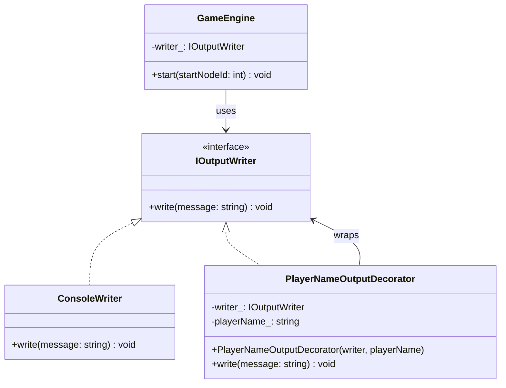
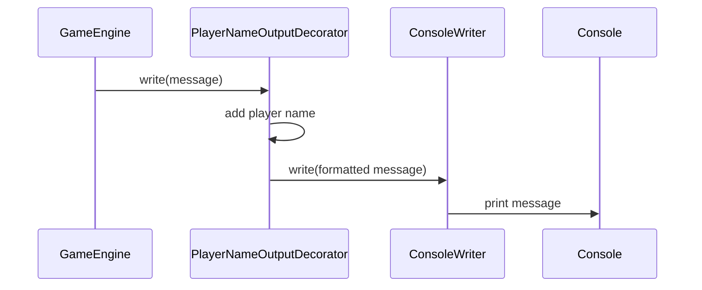
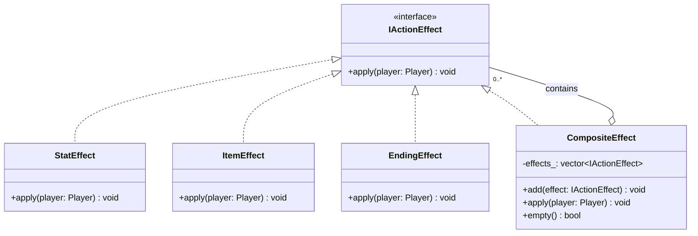
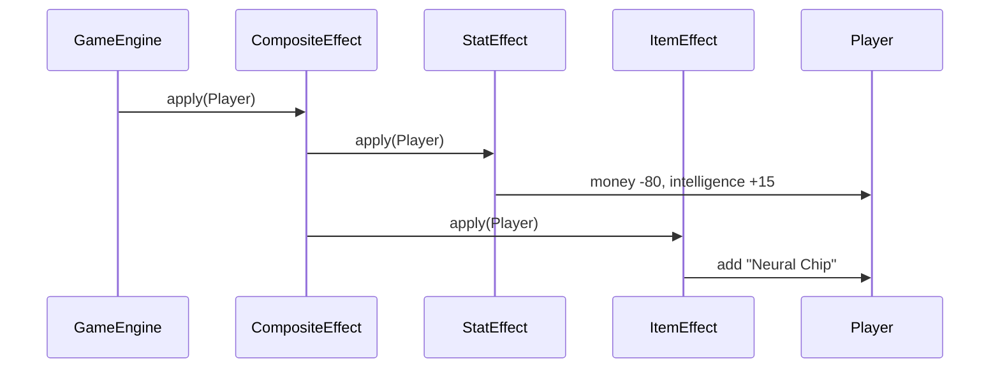
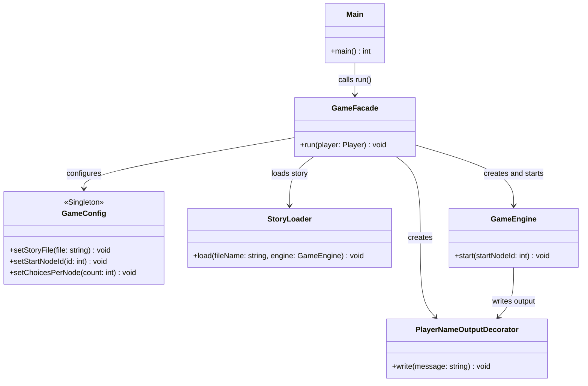
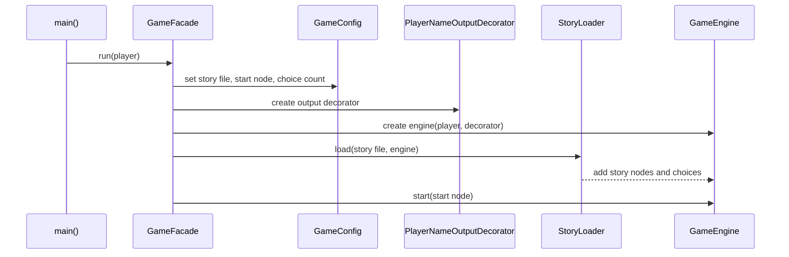
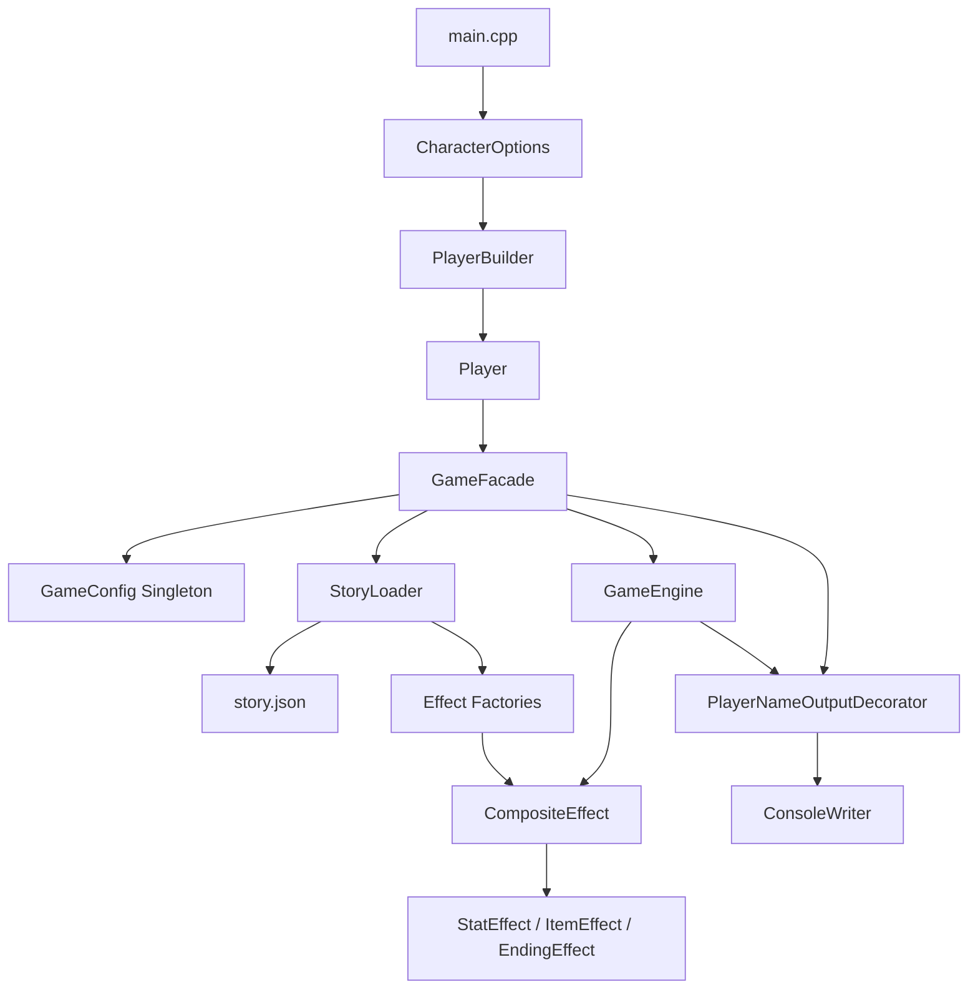

# Laboratory Work No. 2

**Course:** TMPS (Software Modeling and Design Techniques)  
**Topic:** Structural Design Patterns in FAF City: Choose Your Destiny  
**Language:** C++17

## 1. Objective

This laboratory continues the adventure game from Laboratory Works No. 0 and
No. 1. The previous behavior and the previous creational patterns are kept:

- Builder creates and validates `Player` objects;
- Factory Method creates action effects from JSON;
- Singleton stores application configuration.

This laboratory adds three structural design patterns:

1. Decorator;
2. Composite;
3. Facade.

The game also supports selecting a predefined character or creating a custom
character.

Custom numeric input is validated before it is accepted: health and
intelligence must be between 0 and 100, money must be non-negative, and
reputation must be between -100 and 100. Invalid values are rejected and the
same prompt is displayed again. Game messages and choice prompts address the
player by the selected or custom name.

## 2. Project structure

```text
lab2/
├── story.json              # story nodes, choices, requirements, and effects
├── nlohmann/json.hpp       # JSON library
├── GameInterfaces.h        # IActionEffect and IOutputWriter
├── StoryEntities.h         # Player, effects, choices, and story nodes
├── StoryLoader.h           # JSON loading and effect composition
├── GameEngine.h            # game loop and story navigation
├── PlayerBuilder.h         # Lab 1 Builder
├── EffectFactories.h       # Lab 1 Factory Method
├── GameConfig.h            # Lab 1 Singleton
├── CharacterOptions.h      # preset and custom character creation
├── OutputDecorators.h      # Decorator implementation
├── EffectComposites.h      # Composite implementation
├── GameFacade.h            # Facade implementation
├── main.cpp                # input and application entry point
└── REPORT.md               # laboratory report
```

## 3. Existing architecture

The game is a terminal-based choose-your-own-adventure application. The
`Player` stores health, money, intelligence, reputation, inventory, and ending
state. `StoryNode` stores narrative text and choices. `StoryLoader` reads the
story graph from JSON, while `GameEngine` validates choices, applies effects,
and navigates to the next node.

The important extension points from the previous laboratories are:

```cpp
class IActionEffect {
public:
    virtual ~IActionEffect() = default;
    virtual void apply(Player& player) = 0;
};

class IOutputWriter {
public:
    virtual ~IOutputWriter() = default;
    virtual void write(const string& message) = 0;
};
```

The Lab 2 structural patterns reuse these abstractions instead of introducing
a separate game-flow architecture.

## 4. Character selection and creation

### 4.1 Motivation

Previously, `main()` always requested all player statistics manually. Lab 2
adds three predefined character configurations and a custom option:

| Character | Health | Money | Intelligence | Reputation | Description |
|---|---:|---:|---:|---:|---|
| The Tycoon | 100 | 1000 | 5 | 10 | Rich but not very intelligent |
| The Hacker | 20 | 150 | 100 | 5 | Very intelligent but physically fragile |
| The Survivor | 100 | 20 | 15 | 20 | Poor, but healthy and street-smart |
| Custom | User input | User input | User input | User input | Created by the player |

### 4.2 Implementation

`CharacterOptions.h` stores immutable preset data in `CharacterPreset`.
`buildSelectedCharacter()` displays the menu. A selected preset is translated
into the existing `PlayerBuilder`, so validation and construction remain in one
place. The custom branch also uses the same builder.

```cpp
const CharacterPreset& preset = presets[selection - 1];
PlayerBuilder builder;
builder.setName(preset.name)
    .setHealth(preset.health)
    .setMoney(preset.money)
    .setIntelligence(preset.intelligence)
    .setReputation(preset.reputation);
```

This avoids duplicating the `Player` construction logic and preserves the Lab 1
Builder pattern.

## 5. Decorator pattern

### 5.1 Intent

Decorator adds responsibilities to an object dynamically while preserving its
interface.

### 5.2 Problem

The game engine writes messages through `IOutputWriter`. The application needs
to add the selected player's name to every game message, but this formatting
should not be placed inside `GameEngine` or duplicated in every output
implementation.

### 5.3 Implementation

`PlayerNameOutputDecorator` implements the same `IOutputWriter` interface and
wraps another writer. It adds the player name, then delegates the formatted
message to the wrapped writer:

```cpp
class PlayerNameOutputDecorator final : public IOutputWriter {
private:
    IOutputWriter& writer_;
    string playerName_;

public:
    PlayerNameOutputDecorator(IOutputWriter& writer, string playerName)
        : writer_(writer), playerName_(move(playerName)) {}

    void write(const string& message) override {
        writer_.write(playerName_ + ", " + message);
    }
};
```

### 5.4 Participants

| Participant | Class |
|---|---|
| Component | `IOutputWriter` |
| Concrete component | `ConsoleWriter` |
| Decorator | `PlayerNameOutputDecorator` |
| Client | `GameEngine` through `GameFacade` |

### 5.5 Usage

```cpp
ConsoleWriter consoleWriter;
PlayerNameOutputDecorator writer(consoleWriter, player.name());
GameEngine engine(player, writer);
```

The engine only knows `IOutputWriter`. Additional decorators can be added later
for timestamps, file logging, or colored output without changing the engine.

### 5.6 Benefits and trade-offs

The decorator keeps formatting separate from game logic, preserves the output
interface, and allows responsibilities to be composed. The trade-off is an
additional wrapper object and an extra delegation call.

## 6. Composite pattern

### 6.1 Intent

Composite composes objects into tree structures and lets clients treat an
individual object and a group of objects uniformly.

### 6.2 Problem

A story choice may contain several effects. For example, buying a Neural Chip
both changes statistics and adds an item:

```json
"effects": [
  {"type": "stat", "money": -80, "intelligence": 15},
  {"type": "item", "item": "Neural Chip"}
]
```

The effects should be applied as one choice action.

### 6.3 Implementation

`CompositeEffect` implements the same `IActionEffect` interface as every leaf
effect:

```cpp
class CompositeEffect final : public IActionEffect {
private:
    vector<shared_ptr<IActionEffect>> effects_;

public:
    void add(shared_ptr<IActionEffect> effect) {
        if (effect) {
            effects_.push_back(move(effect));
        }
    }

    void apply(Player& player) override {
        for (const auto& effect : effects_) {
            effect->apply(player);
        }
    }
};
```

During JSON loading, all effects belonging to a choice are placed in one
composite. The `Choice` stores one `shared_ptr<IActionEffect>`, which can be a
leaf or a composite. The engine only performs:

```cpp
if (selected.effect) {
    selected.effect->apply(player_);
}
```

### 6.4 Participants

| Participant | Class |
|---|---|
| Component | `IActionEffect` |
| Leaf components | `StatEffect`, `ItemEffect`, `EndingEffect` |
| Composite | `CompositeEffect` |
| Client | `StoryLoader` and `GameEngine` |

### 6.5 Object structure

```text
CompositeEffect
├── StatEffect
└── ItemEffect
```

This makes the loader and engine independent of the number and concrete types
of effects in a choice.

### 6.6 Benefits and trade-offs

Composite makes grouped actions easy to extend and keeps the engine simple.
The trade-off is that an object representing one effect can also contain many
effects, so the object structure must be documented clearly.

## 7. Facade pattern

### 7.1 Intent

Facade provides a simple interface to a complex subsystem.

### 7.2 Problem

Without a facade, `main()` must know the order of multiple operations:

1. configure `GameConfig`;
2. create the player;
3. create the output implementation;
4. construct `GameEngine`;
5. load the story;
6. start the engine.

### 7.3 Implementation

``GameFacade::run()` coordinates the subsystem classes:

```cpp
class GameFacade {
public:
    void run(Player player) const {
        GameConfig& config = GameConfig::instance();
        config.setStoryFile("story.json");
        config.setStartNodeId(1);
        config.setChoicesPerNode(3);

        ConsoleWriter consoleWriter;
        PlayerNameOutputDecorator writer(consoleWriter, player.name());
        GameEngine engine(player, writer);
        StoryLoader loader;
        loader.load(config.storyFile(), engine);
        engine.start(config.startNodeId());
    }
};
```

The entry point only selects or creates a player and starts the facade:

```cpp
Player player = buildSelectedCharacter();
GameFacade game;
game.run(move(player));
```

### 7.4 Participants

| Participant | Class |
|---|---|
| Facade | `GameFacade` |
| Subsystems | `GameConfig`, `StoryLoader`, `GameEngine`, `PlayerNameOutputDecorator` |
| Client | `main()` |

### 7.5 Benefits and trade-offs

Facade reduces coupling between the entry point and the subsystem classes. It
also gives the application one clear startup operation. The trade-off is that
the facade can become too large if unrelated responsibilities are continuously
added to it.

## 8. Combined architecture

## 8.1. Design pattern diagrams

The following diagrams show how the three structural design patterns are
implemented and used in the application.

### 8.1.1. Decorator pattern

The `GameEngine` uses `IOutputWriter`, while `PlayerNameOutputDecorator`
adds player-specific formatting and delegates the result to `ConsoleWriter`.



The output flow is:



### 8.1.2. Composite pattern

Every action effect implements `IActionEffect`. A `CompositeEffect` implements
the same interface, but stores a collection of effects and applies them in
sequence. This allows the game engine to treat one effect and a group of
effects uniformly.



For example, buying a Neural Chip is represented by one composite containing
two effects:



### 8.1.3. Facade pattern

`GameFacade` provides one simple entry point for starting the game. It
coordinates configuration, output adaptation, story loading, and game
execution, so `main()` does not depend on the internal startup sequence.



The startup sequence hidden by the facade is:



### 8.1.4. Overall Lab 2 architecture

The three patterns work together as shown below. Character selection creates a
valid player, the facade starts the application, the loader builds composite effects from
JSON, and the decorator adds player-specific formatting to console output.



## 9. Verification scenarios

The following scenarios should be checked:

1. Select **The Tycoon** and confirm the player starts with 1000 money and low
   intelligence.
2. Select **The Hacker** and confirm the player starts with low health, high
   intelligence, and a Neural Chip.
3. Select **The Survivor** and confirm the player starts poor, healthy, and
   with a Medkit.
4. Choose custom character creation and verify valid values are accepted.
5. Enter invalid custom values and verify the existing Builder validation
   reports an explicit error.
6. Select a choice with multiple JSON effects and verify all effects are
   applied by `CompositeEffect`.
7. Verify game messages pass through `PlayerNameOutputDecorator`.
8. Verify the complete game starts through `GameFacade`.
9. Verify invalid choices, missing items, insufficient intelligence, missing
   story files, and ending effects retain their previous behavior.

## 10. Compilation and execution

From the repository root, compile with a C++17 compiler:

```powershell
g++ -std=c++17 -Wall -Wextra -pedantic lab2\main.cpp -o lab2\main.exe
```

Run the program from the `lab2` directory so that `story.json` is found:

```powershell
Set-Location lab2
.\main.exe
```

## 11. Conclusion

The Lab 2 implementation extends the existing game without changing the
previous laboratory directories. Decorator adds player-specific output
formatting, Composite models a choice containing multiple effects, and Facade
simplifies application startup. Character presets and custom creation provide
multiple ways to construct a valid `Player` while reusing the Lab 1 Builder
and its validation rules.
