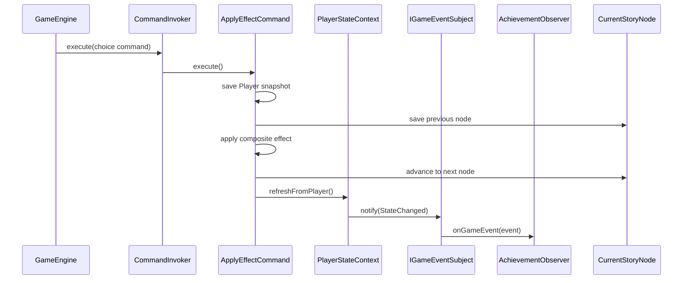
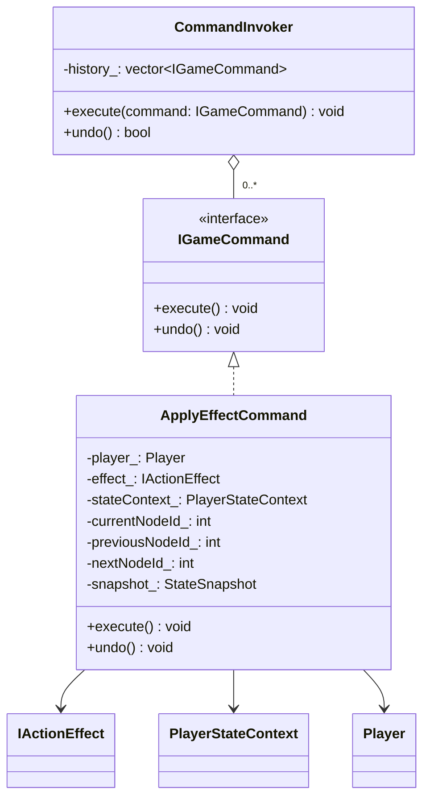
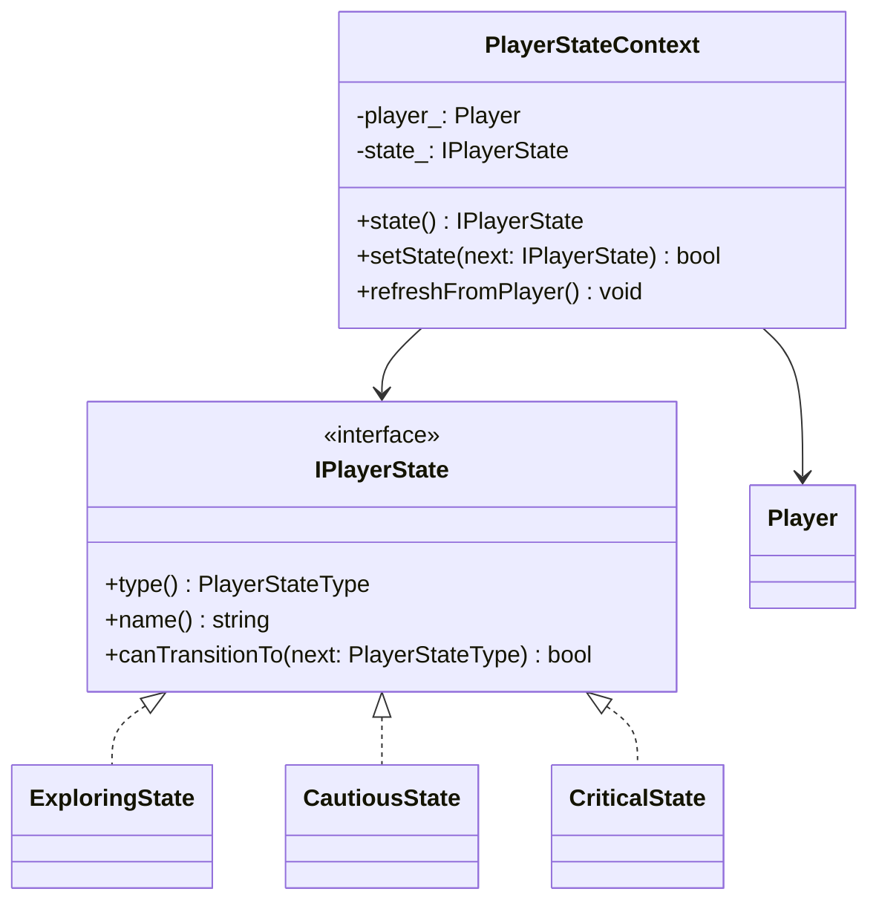
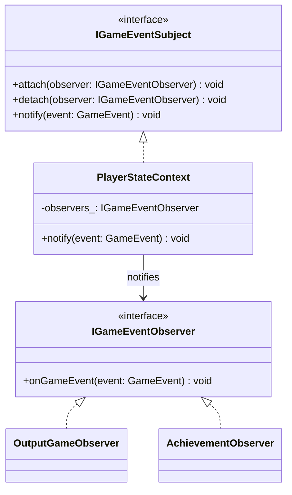

# Laboratory Work No. 3 - Behavioral Design Patterns

**Course:** TMPS  
**Language:** C++17  
**Domain:** FAF City choose-your-own-adventure game

## 1. Domain description

The application is a terminal adventure game in which the player chooses a
character, navigates story nodes, gains or loses resources, and reaches an
ending. Lab 3 adds reversible story choices through Command, derives the
player's state from health, and notifies observers when that state changes.
The implementation continues the Lab 2 Builder, Factory Method, Singleton,
Decorator, Composite, and Facade patterns.

## 2. Pattern interactions

The main execution path is:



`CommandInvoker::undo()` restores both the player's snapshot and the previous
story-node ID, so the game displays the question again. Command, State, and
Observer cooperate in the same execution path.

## 3. Command

### Intent

Command encapsulates a request as an object with `execute` and `undo`, allowing
the invoker to queue or reverse operations without knowing their implementation.

### Fit

A story choice can change several player fields through Lab 2's Composite
effect and advances the story to another node. `ApplyEffectCommand` saves the
player snapshot and previous node ID, applies the effect, and advances the
current node. Undo restores both, while `CommandInvoker` owns command history.

### UML class diagram



### Key code

Source: [Behavioral/Command.h](Behavioral/Command.h)

```cpp
void execute() override {
    snapshot_ = player_.saveState();
    if (effect_) effect_->apply(player_);
    stateContext_.refreshFromPlayer();
    currentNodeId_ = nextNodeId_;
    executed_ = true;
}

void undo() override {
    if (!executed_) return;
    player_.restoreState(snapshot_);
    currentNodeId_ = previousNodeId_;
    stateContext_.refreshFromPlayer();
    executed_ = false;
}

bool undo() {
    if (history_.empty()) return false;
    history_.back()->undo();
    history_.pop_back();
    return true;
}
```

The command saves the player's snapshot and previous node before applying the
choice effect. It then advances the current node. Undo restores both the
player and story position, and refreshes the state context. The invoker knows
only `IGameCommand`, not the concrete operation.

### Unit tests

- `commandExecuteAndUndoRestoreSnapshot`: executes a stat-effect command,
  verifies changed values, then proves undo restores health, money,
  intelligence, reputation, and the previous story-node ID.
- `gameUndoReturnsToThePreviousQuestion`: undoes choices across two branches
  and verifies that each prior question and player snapshot are restored.
- `mementoUndoPreservesInventoryAndEnding`: saves a player snapshot, creates
  later changes, restores it, and proves inventory and game-over state return
  to the saved values.

## 4. State

### Intent

State allows an object to change behavior as its internal state changes and
encapsulates valid transitions in state classes.

### Fit

The player's health naturally creates three operating modes: Exploring,
Cautious, and Critical. `PlayerStateContext` derives the target state after
every command, while concrete states define which transitions are legal.

### UML class diagram



### Key code

Source: [Behavioral/State.h](Behavioral/State.h)

```cpp
void refreshFromPlayer() {
    const int health = player_.health();
    PlayerStateType target = health <= 20 ? PlayerStateType::Critical
                           : health <= 50 ? PlayerStateType::Cautious
                                          : PlayerStateType::Exploring;
    if (target == state_->type()) return;
    if (target == PlayerStateType::Critical) {
        if (state_->type() == PlayerStateType::Exploring)
            setState(make_unique<CautiousState>());
        if (state_->type() == PlayerStateType::Cautious)
            setState(make_unique<CriticalState>());
    }
}
```

The context reads current health and moves through legal state transitions.
There is no state enum switch in the game engine; the engine only asks the
context to refresh.

### Unit tests

- `stateSupportsValidTransitions`: proves Exploring -> Cautious ->
  Critical -> Cautious transitions are accepted.
- `stateRejectsForbiddenTransitions`: proves Exploring cannot enter Critical
  directly and the context remains in its previous state.

## 5. Observer

### Intent

Observer lets a subject notify multiple dependent objects about state changes
without referencing their concrete classes.

### Fit

State changes are gameplay events. `PlayerStateContext` is the subject. The
output observer prints state transitions, while the achievement observer
tracks entries into Critical. Observers can be attached or detached at runtime.

### UML class diagram



### Key code

Source: [Behavioral/Observer.h](Behavioral/Observer.h)

```cpp
void notify(const GameEvent& event) override {
    for (auto* observer : observers_) observer->onGameEvent(event);
}

void onGameEvent(const GameEvent& event) override {
    ++stateChanges_;
    if (event.type == GameEventType::StateChanged &&
        event.to == "Critical")
        ++criticalEntries_;
}
```

The subject stores interfaces and never depends on concrete observer classes.
The output observer displays transitions, and the achievement observer counts
state changes and entries into Critical.

### Unit tests

- `observerNotifiesSubscribersAndSupportsUnsubscribe`: attaches two observers,
  detaches one, then proves attached and detached notification counts are
  correct.
- `observerReceivesCriticalStateChange`: proves the achievement observer
  counts entry into the Critical state exactly once.

## 6. Integration with Lab 2

Lab 3 uses Lab 2 abstractions instead of replacing them:

- `IActionEffect` and `CompositeEffect` remain the receiver operation used by
  `ApplyEffectCommand`;
- `IOutputWriter` and the decorator chain remain the output abstraction used
  by `OutputGameObserver`;
- `PlayerBuilder` continues character construction;
- `StoryLoader` continues loading JSON and creating effects;
- `GameFacade` creates the engine and attaches output and achievement
  observers.

This satisfies the Lab 3 requirement to build on structural and creational
patterns already implemented in Lab 2.

## 7. Unit-test evidence

The test executable was rebuilt with C++17 warnings enabled and all tests
passed. It is run with:

```text
cd lab3
g++ -std=c++17 -Wall -Wextra -pedantic tests.cpp -o tests.exe
tests.exe
```

Passing log:

```text
All Lab 3 tests passed.
```

The test suite includes all previous Lab 2 tests plus eight Lab 3 tests:
two State tests, four Command/snapshot/undo tests, and two Observer tests.

## 8. Conclusions

The main challenge was integrating Command, State, and Observer without
creating isolated demonstrations. A command updates the player and story
position, refreshes the state, and can restore both the player and previous
question when undone. State transitions also have to respect valid edges
instead of jumping directly between incompatible states.

For a future redesign, the command history could support redo and a bounded
history size. After a terminal choice, the player can still undo it and return
to the previous question, or explicitly finish the game.
